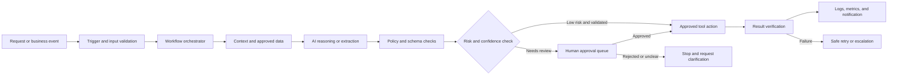
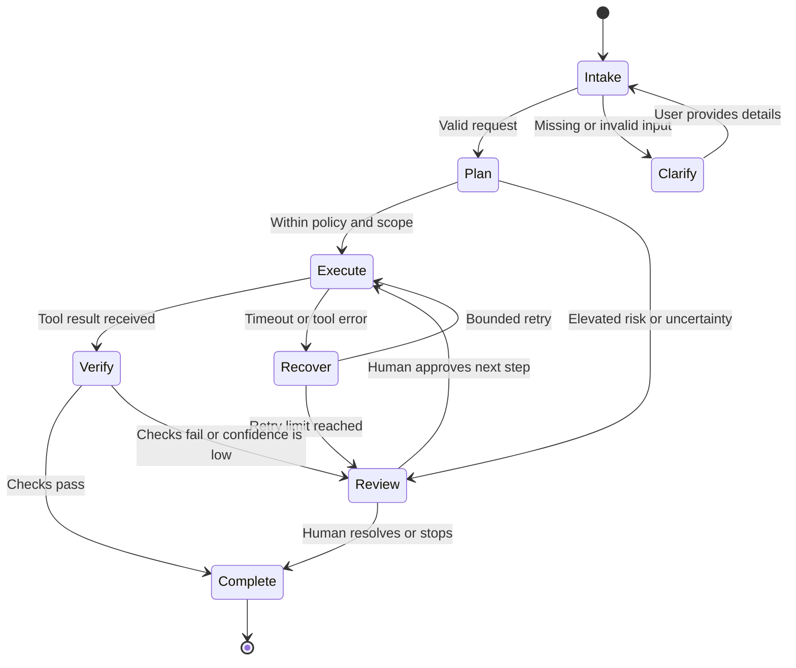

<!-- ===================================================== -->
<!-- MUZAFFAR ALI | AI & AUTOMATION PROFILE                 -->
<!-- GitHub Profile Repository: Muzaffar-Ali-3              -->
<!-- ===================================================== -->

### Turning complex workflows into practical, human-centered systems

**AI Automation • Agentic Workflow Design • eCommerce Operations • Project Management**

---

## About

I’m **Muzaffar Ali**, an executive-level freelance specialist with experience across project management, data operations, eCommerce, and digital business systems. I’m exploring how AI and automation can make everyday business workflows more consistent, measurable, and useful.

My focus is on practical solutions: define the process, connect the right tools, add appropriate human review, and measure whether the result improves the work. The advanced AI and agentic patterns below describe my design interests and roadmap—not claims that every system is currently deployed.

### Areas of focus

- AI-assisted business workflows and workflow orchestration
- Agentic AI concepts, tool use, and multi-step task design
- Human-in-the-loop review and responsible automation
- eCommerce and marketplace operations
- Project coordination, documentation, and reporting
- WordPress and digital presence solutions
- Cybersecurity awareness and privacy-conscious technology use

---

## Advanced AI automation

### Automation design principles

1. **Start with a bounded task:** define the input, expected output, constraints, and success criteria.
2. **Use the simplest reliable workflow:** deterministic automation for predictable steps; AI for tasks that benefit from interpretation or generation.
3. **Keep people in control:** require approval for consequential, external, financial, or irreversible actions.
4. **Design for failure:** validate inputs and outputs, handle timeouts, retries, duplicate events, and unavailable services.
5. **Protect data:** minimize collection, restrict access, avoid exposing secrets, and define retention expectations.
6. **Measure outcomes:** monitor quality, latency, exceptions, and the time or effort saved.

### Reference architecture

*This is a conceptual reference design. Specific integrations, safeguards, and deployment requirements depend on the use case.*

### Example workflow patterns

| Workflow | AI-assisted step | Automation and control | Example outcome |
|---|---|---|---|
| Support request triage | Classify topic, urgency, and missing details | Validate fields; route uncertain cases to a person | Organized queue with suggested next steps |
| Business document intake | Extract key fields and summarize | Check required fields and source; review before records are changed | Faster, more consistent data entry |
| eCommerce content operations | Draft product copy from approved facts | Enforce format and prohibited-claims checks; approve before publishing | Review-ready listings and content |
| Meeting-to-task workflow | Summarize decisions and propose action items | Confirm owners and dates; human approves task creation | Traceable follow-up actions |
| Reporting assistant | Explain trends in an approved dataset | Validate calculations and cite data sources; review before sharing | Faster first-draft reporting |

### Agentic workflow lifecycle

**Important guardrails:** narrowly scoped tool permissions, allowlisted actions, structured inputs and outputs, approval gates, bounded retries, duplicate-action protection, audit-friendly logs, and a clear stop/escalation path. An AI agent should not be given unrestricted access to accounts, sensitive data, or consequential actions.

---

## Hackathon Enterprises

**Hackathon Enterprises** is my technology startup vision for exploring useful AI ecosystems, intelligent automation, software innovation, and enterprise technology.

Potential areas of exploration:

- AI-enabled business operations and workflow tools
- Agentic systems with defined roles and limited tool access
- Human-centered automation and responsible AI practices
- Business intelligence and decision-support concepts
- Secure, maintainable digital products

*This is a proposed direction and research vision, not a representation that these products or services are already deployed.*

---

## Technology and working toolkit

### Web and documentation

### AI and productivity tools

### Business operations

- Microsoft Excel and Google Sheets
- Project and task management
- SEO, content optimization, and data reporting
- Workflow mapping, documentation, and process improvement

---

## Projects and development roadmap

| Project | Focus | Status |
|---|---|---|
| Hackathon Enterprises | AI ecosystem and enterprise technology vision | Concept / Research |
| Professional Portfolio | Personal professional website | Portfolio |
| eCommerce Solutions | Marketplace and online store operations | Services |
| Business Dashboards | Spreadsheet-based reporting and analysis | Portfolio |
| AI Workflow Concepts | Human-reviewed automation and agent workflow patterns | Research |

> Add links to public repositories and demonstrations as they become available. Clearly label prototypes, experiments, and production deployments.

### Roadmap

- [x] Establish a professional brand and digital portfolio
- [x] Build eCommerce and IT service expertise
- [ ] Publish documented AI-assisted workflow prototypes
- [ ] Demonstrate input validation, human approval, and safe failure handling
- [ ] Develop bounded multi-agent proof of concepts
- [ ] Publish enterprise automation demonstrations with evaluation criteria
- [ ] Expand responsible AI, privacy, and security documentation
- [ ] Share open-source projects and practical implementation notes

---

## Experience

**Data Entry Supervisor** — Data-Based Company | 2018–2021  
**Project Manager** — Archiving & Data Solutions Pvt Ltd | 2013–2017  
**Education:** Bachelor's Degree — Punjab University, Lahore

---

## GitHub activity

---

## Connect

**Let’s connect, collaborate, and build meaningful technology solutions.**

📍 Lahore, Pakistan  
📧 [muzaffarali53pk@gmail.com](mailto:muzaffarali53pk@gmail.com)  
🌐 [Professional Portfolio](https://muzaffarali3.github.io/muzaffarali-portfolio/)  
💼 [LinkedIn Profile](https://www.linkedin.com/in/muzaffar-ali-74850130b/)

**INNOVATE • BUILD • AUTOMATE • EVOLVE**

