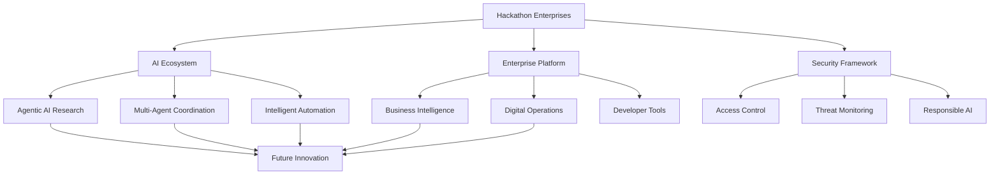

<!-- ===================================================== -->
<!-- MUZAFFAR ALI | AI TECHNOLOGY COMMAND CENTER            -->
<!-- GitHub Profile Repository: muzaffarali53pk             -->
<!-- ===================================================== -->

 

---

## ◈ ABOUT ME

I am **Muzaffar Ali**, an Executive-Level Freelance Specialist focused on advanced IT solutions, project management, digital operations, eCommerce, and technology-driven business development.

My professional interests include emerging AI technologies, intelligent automation, agentic AI architectures, cybersecurity, and enterprise digital transformation.

I aim to combine practical business experience with modern technology to develop useful, scalable, and responsible digital solutions.

### Professional Focus

- AI Technology & Intelligent Automation
- Agentic AI Research & Multi-Agent Architecture Concepts
- Enterprise IT & Project Management
- eCommerce Operations & Marketplace Management
- WordPress Development & Website Solutions
- Cybersecurity Awareness & Technology Setup
- Digital Business Systems & Workflow Optimization

---

## ◈ HACKATHON ENTERPRISES

### BUILDING THE NEXT GENERATION OF INTELLIGENT TECHNOLOGY

**AI Ecosystem • Agentic Systems • Enterprise Automation**

Hackathon Enterprises is my technology startup vision focused on exploring advanced AI ecosystems, intelligent agents, automation, software innovation, and enterprise technology.

### Proposed Technology Architecture

*This architecture represents a proposed development vision, not a claim that all components are currently deployed.*

---

## ◈ TECHNOLOGY & SKILLS

### Development & Web Technologies

### AI & Productivity

### Business & eCommerce

### Operations & Analytics

- Microsoft Excel and Google Sheets
- Project and task management
- SEO and content optimization
- Data management and reporting
- Digital workflow automation
- Business documentation

---

## ◈ FEATURED PROJECTS

| Project | Description | Status |
|---|---|---|
| Hackathon Enterprises | AI ecosystem and enterprise technology vision | Concept / Research |
| Professional Portfolio | Personal professional website | Portfolio |
| eCommerce Solutions | Marketplace and online store operations | Services |
| Business Dashboards | Spreadsheet-based reporting and analysis | Portfolio |
| AI Workflow Concepts | Intelligent automation and agent workflows | Research |

> Replace these entries with links to actual public repositories and demonstrations as you publish them.

---

## ◈ GITHUB ANALYTICS

### Contribution Activity

---

## ◈ PROFESSIONAL EXPERIENCE

**Data Entry Supervisor**  
Data-Based Company | 2018–2021

**Project Manager**  
Archiving & Data Solutions Pvt Ltd | 2013–2017

**Education:** Bachelor's Degree — Punjab University, Lahore

---

## ◈ DEVELOPMENT ROADMAP

- [x] Establish personal professional brand
- [x] Develop digital portfolio
- [x] Build eCommerce and IT service expertise
- [ ] Publish AI and automation prototypes
- [ ] Develop multi-agent system proof of concepts
- [ ] Build enterprise technology demonstrations
- [ ] Expand cybersecurity and responsible AI frameworks
- [ ] Publish documented open-source projects

---

## ◈ CONNECT WITH ME

**Let's connect, collaborate, and build meaningful technology solutions.**

📍 Lahore, Pakistan

📧 muzaffarali53pk@gmail.com

🌐 [Professional Portfolio](https://muzaffarali3.github.io/muzaffarali-portfolio/)

💼 [LinkedIn Profile](https://www.linkedin.com/in/muzaffar-ali-74850130b/)

**INNOVATE • BUILD • AUTOMATE • EVOLVE**

